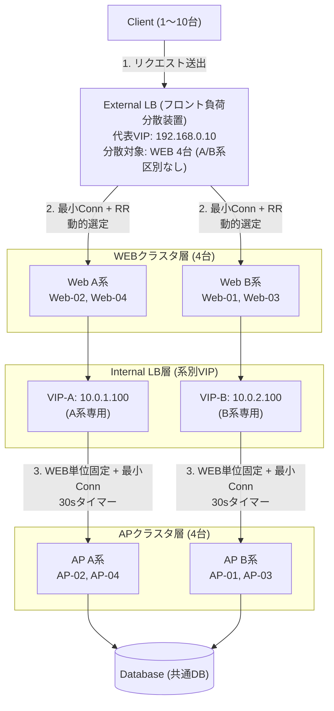

# A系/B系 分離型Web・APクラスタ 負荷分散＆リリースシミュレーター

新任・若手エンジニアおよびインフラ・ネットワーク担当者向けに、A系・B系でクラスタが構成されたマルチティアWebシステムにおいて、**「実務運用ジョブ（waitあり/waitなし切離・組込）」**、**「External LB / Internal LB の負荷分散振る舞い仕様」**、**「APサーバ単位のJSESSIONID採番とスティッキーセッション」**、**「各サーバ（Web/AP/DB）での処理滞留時間」**、**「HTTPリクエスト往復フロー（行き: 青 / 帰り: 緑 / エラー: 赤）」**、**「SORRYサーバ連動」**の挙動を視覚的かつインタラクティブに検証・理解できるWebベースのシミュレーションツールです。

---

## 🌐 負荷分散装置（External LB / Internal LB）の仕様と振る舞いルール

ネットワーク担当者・インフラエンジニアとの仕様確認用として、本エミュレータが実装している負荷分散仕様・アルゴリズム・パーシステンス・フェイルオーバーの振る舞いを以下に詳述します。



---

### 1. External LB（フロント負荷分散装置: Client ➜ WEB）

| 項目 | エミュレータの振る舞い仕様 | 実務NW機器での相当設計・備考 |
| :--- | :--- | :--- |
| **配置・役割** | インターネット／クライアントからの全トラフィックを受け付ける単一の代表VIP（`192.168.0.10`）。 | F5 BIG-IP / AWS ALB / A10 Thunder などの外側ロードバランサー |
| **分散対象サーバ** | **全WEBサーバ 4台（Web-01, Web-02, Web-03, Web-04）**。<br/>※**クライアントごとのA系/B系縛りや固定は一切なし**。全クライアントが全Webサーバを均等に利用します。 | 単一のプール/ターゲットグループに4台のWebを収容 |
| **動的ディスパッチ** | クライアント発射時点では宛先Webは未決定。パケットが**External LBに物理到着した瞬間**に最新コネクション数を評価して転送先Webを決定。 | 現実のTCPパケット到着時のディスパッチタイミングと一致 |
| **負荷分散アルゴリズム** | **最小コネクション優先（Least Connections）**<br/>＋ **同数時ラウンドロビン（Round-Robin Fallback）** | `least-connections` 設定時の標準タイブレーク仕様 |
| └ **コネクション差がある時** | 稼働中（`up/active`）Webの中で、**アクティブコネクション数が最も少ないWebサーバ**へ優先ディスパッチ。<br/>（例: Web-01が1件処理中、Web-02〜04が0件の場合、0件のWeb-02〜04へ振られる） | 過負荷サーバの回避と均等平準化 |
| └ **コネクション同数の時** | 無風状態（全台0件）や同数の場合は、**号機順にラウンドロビン（Web-01 ➜ Web-02 ➜ Web-03 ➜ Web-04 ➜ Web-01...）**で順繰りに巡回。 | 連続・単発リクエストが特定号機へ偏ることを防止 |
| **セッション維持<br/>（パーシステンス）** | **Cookie Sticky Session（JSESSIONID維持）**<br/>クライアントが既存の正常なセッションCookieを保持している場合、セッションテーブルに従い同一Webサーバへ優先転送。 | HTTP Cookieインスペクションによるパーシステンス |
| **コネクション管理<br/>（Active Connections）** | External LBがWebサーバへディスパッチした瞬間からカウント開始（+1）。Webがリバースプロキシとして後段（AP/DB）の処理を待機中も維持され、レスポンスがExternal LBを抜けてクライアントへ返却された瞬間に解放（-1）。 | インフライト接続数（並行処理数）の厳密なカウント |
| **障害・切離し時の挙動** | ・**`up/under-maintenance(manual)`（waitあり）**: 新規接続は他系へ迂回。既存セッションはwait時間（30秒）中のみ維持（Graceful Drain）。<br/>・**`up/under-maintenance(manual)`（waitなし） / `down/-`**: 即座に転送停止。既存セッションは破棄。<br/>・**WEB全4台停止時**: **SORRYサーバ（up/active）**が自動昇格し、503 Sorry Page を返却。 | ヘルスチェックダウン時のプール除外およびSorry昇格 |

---

### 2. Internal LB（内部負荷分散装置: WEB ➜ AP）

| 項目 | エミュレータの振る舞い仕様 | 実務NW機器での相当設計・備考 |
| :--- | :--- | :--- |
| **配置・役割** | WEB層とAP層の間に位置する内部ロードバランサー。系ごとに独立した代表VIPを配備。<br/>・**A系代表VIP**: `node-vip_a`（`10.0.1.100`）<br/>・**B系代表VIP**: `node-vip_b`（`10.0.2.100`） | 内部レイヤー4/レイヤー7ロードバランサー |
| **系分離ルール** | Webサーバの所属系に応じて中継VIPが決定。<br/>・Web A系（Web-02, 04） ➜ **VIP-A** 経由で **AP A系（AP-02, AP-04）** へ<br/>・Web B系（Web-01, 03） ➜ **VIP-B** 経由で **AP B系（AP-01, AP-03）** へ | 系間クラスタ分離アーキテクチャの厳守 |
| **動的ディスパッチ** | パケットがWebサーバを出て**Internal LB（VIP-A / VIP-B）に物理到着した瞬間**に最新APコネクション数を評価して転送先APを決定。 | リバースプロキシからの内部中継時の動的ディスパッチ |
| **基本パーシステンス** | **WEBサーバ単位でAPサーバに固定（送信元IPパーシステンス類似）**<br/>例: Web-01からのリクエストはAP-01へ固定、Web-02からのリクエストはAP-02へ固定。 | 送信元IPアドレス（Source IP Persistence）による同一AP固定 |
| **負荷分散アルゴリズム<br/>（初回 / 混雑時）** | **最小コネクション優先（Least Connections）**<br/>1. 該当系の稼働中APの中で、**アクティブコネクション数が最小のAP**を選定。<br/>2. 最小コネクションが同数の場合:<br/>　- すでに固定されているAPが含まれていれば**その固定先を維持**。<br/>　- 未固定時は**「号機が若い順（AP-01 < AP-03, AP-02 < AP-04）」**。<br/>3. **固定先APがビジー（connが多い）で、他に空いているAPがある場合**:<br/>　- 負荷平準化のため、**最小コネクションのAPへ振り分け先を更新**。 | コネクション偏重時の動的リバランス |
| **30秒無通信タイマー<br/>（Idle Timeout）** | 各WebサーバからInternal LB経由でAP宛ての通信が発生した瞬間にタイマーを「30秒」にリセット。<br/>**30秒間通信が途絶えると、WEB-AP固定マッピングが自動解除（リセット）**。<br/>次回通信時に改めて最小コネクション（同数は若い順）でAPを再選定・固定化。 | アイドルタイムアウトによるパーシステンステーブル解放 |
| **AP全台停止時の挙動** | 該当系のAPが全滅（2台とも `down/-`）した場合、リクエストは途絶えず青色（行き）でWebを経由してInternal LB（VIP）まで到達。<br/>Internal LBは転送先APが存在しないため、即座に**HTTP 503 Service Unavailable（赤色パケット）**を生成し、Web ➜ Ext LB ➜ Clientへ折り返し返却。 | 内部LBによる503 Service Unavailable応答保証 |
| **コネクション管理** | Internal LBがAPへディスパッチした瞬間からAPの `activeConnections` をカウント開始（+1）。DB処理中もスレッド/コネクションを保持し、レスポンスがAPを抜けてVIP/Webへ返却されるまで維持。 | APスレッドプール占有状況のリアルタイム監視 |

---

### 3. ネットワーク・負荷分散の挙動確認マトリクス

ネットワーク担当者様との仕様すり合わせ時、以下のシナリオでエミュレータと想定設計を照合できます：

| No | テストシナリオ | エミュレータの振る舞い（期待値） | 検証方法 |
| :---: | :--- | :--- | :--- |
| **1** | **無風状態からの連続単発リクエスト（手動）** | External LBにて `Web-01` ➜ `Web-02` ➜ `Web-03` ➜ `Web-04` と巡回し、特定の号機や片系に偏らない。 | 手動モードで Client-01〜04 を順次クリック |
| **2** | **先行通信中の後続リクエスト（インフライト並行）** | 1発目がWeb-01で通信中（conn=1）の間に届いた2発目は、コネクション0の `Web-02`（または `Web-03`）へ即座に迂回分散。 | 手動モードで連続素早くクリック |
| **3** | **WEB-AP固定ルーティングと維持** | Web-01からのリクエストは AP-01 へ固定され、後続通信もAP-01へ送出される。 | 右パネル「セッション」タブで固定先APを確認 |
| **4** | **30秒無通信による固定解除** | 通信が30秒途絶えるとタイマーが0になり、固定マッピングが解除され `(未固定)` に戻る。 | 30秒放置後にセッションタブを確認 |
| **5** | **WEB単位固定中のAP混雑時フェイルオーバー** | Web-01固定先AP-01が処理中（conn=1）の間に次リクエストが来ると、空いている `AP-03`（conn=0）へ動的ディスパッチ。 | 自動テストシナリオ10で完全検証 |
| **6** | **AP全台停止時の内部エラー返却** | APが全滅してもパケットは消滅せず、Internal LB（VIP）まで行きパケット（青）が到達し、VIPから503エラー（赤）で折り返し返却される。 | 右パネルでAP全台障害を実行 |
| **7** | **Web全台切離し時のSORRY昇格** | Web全台が切離し（またはdown）になると、即座にSORRYサーバが `up/active` に昇格し、Sorry応答を返却。 | ジョブ `WEB全台切離-waitなし` を投入 |

---

---

---

## 🛠️ その他の主要機能と実務運用仕様

### 1. 実務運用ジョブ（9種類のプリセット）
デフォルト状態は「通常稼働」。右側パネルから以下のジョブをワンクリックで投入可能です：

| ジョブ名 | 挙動・処理内容 |
| :--- | :--- |
| **`WEB-A系切離-waitあり`** | Web A系（02, 04）を `up/under-maintenance(manual)` に遷移。**新規通信は即時拒否しつつ、30秒間既存通信（セッション確立済みクライアント）の処理をそのまま維持（Graceful Drain）**。30秒経過（wait満了）後に次回リクエストからもう片系（B系）へ新規振り分け。 |
| **`WEB-A系切離-waitなし`** | Web A系（02, 04）を `up/under-maintenance(manual)` に遷移。**次回以降の新規リクエスト転送を即時停止**（B系へ切り替え）。**すでにExternal LBを通過してWeb/AP/DBでインフライト処理中の通信は、レスポンスまで正常に保証**されます。 |
| **`WEB-A系組込`** | Web A系（02, 04）を `up/active` に復帰。External LBの均等負荷分散を再開。 |
| **`WEB-B系切離-waitあり`** | Web B系（01, 03）の30秒ドレイン切離。wait中は既存セッションを維持、満了後に次回からA系へ切替。 |
| **`WEB-B系切離-waitなし`** | Web B系（01, 03）の即時切離。次回以降の新規転送を即時停止し、通過済みインフライト通信は正常レスポンスを保証。 |
| **`WEB-B系組込`** | Web B系（01, 03）の `up/active` 復帰。 |
| **`WEB全台切離-waitあり`** | Web全4台の30秒ドレイン切離。30秒後に受け手全滅により **SORRYサーバ（up/active）** が発動。 |
| **`WEB全台切離-waitなし`** | Web全4台の即時強制切断切離。即座に **SORRYサーバ（up/active）** が緊急発動。 |
| **`WEB全台組込`** | Web全4台を `up/active` に復帰。SORRYサーバは自動で `up/standby` に戻る。 |

---

### 2. クライアント管理とAPサーバによるJSESSIONID採番ライフサイクル
- **クライアント数スライダー（1〜10台）**:
  - `1. Clients` 列はExternal LBと高さが揃うよう垂直センタリング配置。スライダーでリアルタイムに増減可能。
  - **追加時**: 新規クライアントはセッション未所持（`(新規接続)`）でクリーンに追加。最初のリクエストが成功した瞬間に**到達APにて新しい `JSESSIONID`（例: `JSES-B-AP01-XXXX`）が1回だけ採番**されます。
  - **減少（切断）時**: 離脱クライアントのインフライトパケットは即時破棄（RST切断相当）され、画面外への迷走を完全防止。
- **手動モード（クリック送出）**:
  - トラフィックモードを「手動」に切り替えると、自動パケット送出・一時停止ボタン・Reqスライダーが非表示となり、**各クライアントカードをクリックして1リクエストずつ送出**して挙動をステップ観察できます。
  - 手動切り替え時に全セッション・コネクション・負荷分散状態がクリーンに初期化されます。
- **JSESSIONIDの維持と障害時再採番**:
  - **エラー（赤パケット）を受け取るまでは、同一クライアントで同一のJSESSIONIDを静的に維持**し続けます。
  - 担当AP障害時などエラー受領時のみセッションが破棄され、次回正常応答時に新APで新IDが再採番されます。

---

### 3. サーバ処理滞留時間と可視化フロー
- **処理滞留時間（スライダー調整）**:
  - **WEB滞留**: `0.0s 〜 4.0s`（デフォルト: `0.5s`）
  - **AP滞留**: `0.0s 〜 4.0s`（デフォルト: `1.0s`）
  - **DB滞留**: `0.0s 〜 4.0s`（デフォルト: `0.8s`）
- **パケット色ルール**:
  - **行き（Request）**: **青色**
  - **帰り（200 OK Response）**: **緑色**
  - **エラー返却（503 Service Unavailable）**: **赤色**

---

## ⚙️ 外部定義ファイル (`config.js`) による構成カスタマイズ

本シミュレータは、HTMLコード（`index.html`）を直接変更することなく、同一ディレクトリの外部定義ファイル **`config.js`** を編集することでシステム構成や名称を自由に変更できます。

### カスタマイズ可能な項目
1. **負荷分散NW装置 (`networkDevices`)**:
   - `externalLb`: External LB の表示名、各系のラベル名
   - `internalLb`: VIP-A / VIP-B の代表IP、名称、ルーティング説明
   - `database`: Database の表示名、サブタイトル
2. **サーバ定義 (`servers`)**:
   - `web`: Webサーバ群（`Web-01`〜`04`、`SORRY`）の名称、IPアドレス、所属系（A/B/SORRY）、初期状態
   - `ap`: APサーバ群（`AP-01`〜`04`）の名称、IPアドレス、所属系（A/B）、バージョン、初期状態
3. **実務運用ジョブ定義 (`jobs`)**:
   - 実務運用ジョブの名称（例: `WEB-A系切離-waitあり`）、グループ（A系/B系/全台）、待機時間（`waitDuration: 30`）、バッジ文言、ボタンスタイル

設定ファイルを編集後、ブラウザをリロードするだけで画面全体のトポロジー表示・ジョブボタン・パケットルーティングに自動反映されます。

---

## 🧪 全自動E2Eテストスイート (`test_jobs.py`)

Playwright による 19 項目の全自動統合テストが備わっています（全9ジョブの実行、waitあり/なしのインフライト保証、SORRYサーバ自動昇格・復帰、手動モード切替と1リクエスト送出、WEB-AP固定ルーティング＆30秒タイマー、AP障害フェイルオーバー、External LB 4台最小コネクション＆ラウンドロビン検証等）：

```bash
python test_jobs.py
```

---

## 🚀 起動方法

### 方法1: ブラウザで直接開く
単一の自己完結型 HTML ファイル（`index.html`）のため、ファイルをダブルクリックするか、ブラウザにドラッグ＆ドロップするだけで即座に動作します（外部通信0件・完全オフライン対応）。

### 方法2: ローカルHTTPサーバーで起動
```bash
cd 負荷分散シミュレータ
python -m http.server 8088

# ブラウザでアクセス:
# http://127.0.0.1:8088/index.html
```
